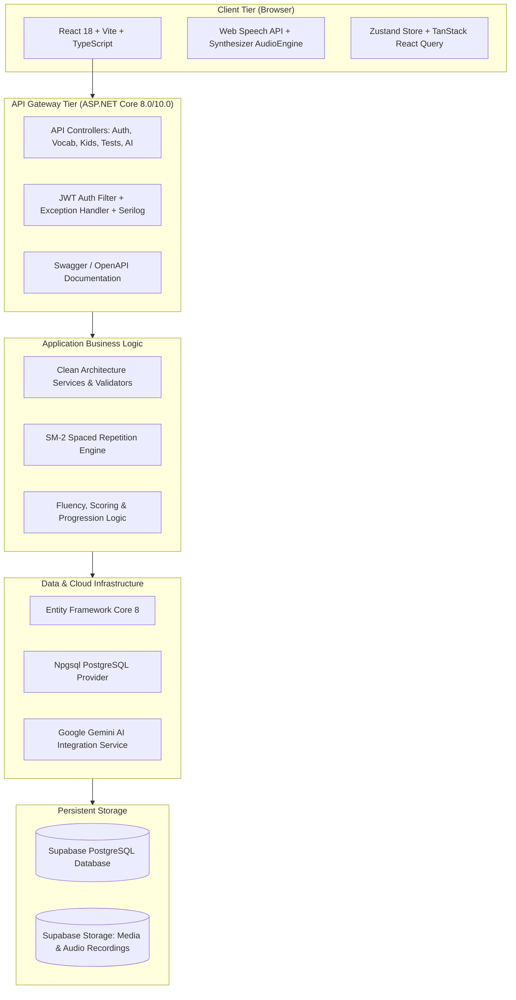

# LINGORA SYSTEM ARCHITECTURE

## 1. High-Level Architecture

LINGORA is engineered as a decoupled modern full-stack web application following Clean Architecture principles on the backend and feature-based modular architecture on the frontend.



## 2. Frontend Architecture (Feature-Based)
```
frontend/
  src/
    app/router/           # Centralized React Router configuration
    components/
      ui/                 # Design System primitives (Button, Card, Badge, Progress, Modal)
      common/             # Shell navigation (Header, Sidebar, BottomNav)
    features/
      landing/            # Commercial landing page
      auth/               # Sign In, Sign Up, Forgot Password, Demo accounts
      onboarding/         # 7-Step animated onboarding & placement calibration
      dashboard/          # Student, Parent, Admin dashboards
      kids/               # 10 Learning Worlds, 10 Playable Games, Virtual Pet Room
      adults/             # 16 Topics, Flashcards, SM-2 SRS, Grammar Master
      toeic/              # Listening Parts 1-4, Reading Parts 5-7, Score predictor
      ielts/              # AI Speaking Room (Core), AI Writing Evaluator (4 criteria)
      test-center/        # Timed Full Mock Exams with question palette
      ai-tutor/           # 5 Personas AI English Tutor with grammar breakdown
      unique-features/    # Life Simulator, Shadowing, Word Universe, Mistake DNA, Focus Mode
      analytics/          # Recharts visualizations & actionable AI guidance
      achievements/       # Badges, XP trophies, Leaderboard
      community/          # Study groups & peer sharing
      settings/           # Profile preferences, sound & theme toggles
    lib/                  # Audio synthesis engine, speech recognition, helpers
    stores/               # Zustand global state (Auth, Theme, Learning)
    types/                # TypeScript domain contracts
```

## 3. Backend Clean Architecture
```
Lingora.Domain/           # Entities, Value Objects, Enums (Zero external dependencies)
Lingora.Application/      # DTOs, Service Interfaces, Validation contracts
Lingora.Infrastructure/   # EF Core DbContext, Npgsql PostgreSQL, JWT, Gemini Client
Lingora.API/              # Controllers, Program.cs, Swagger, Serilog Middleware
```
